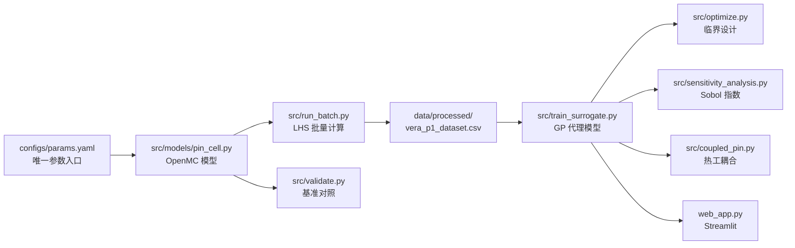
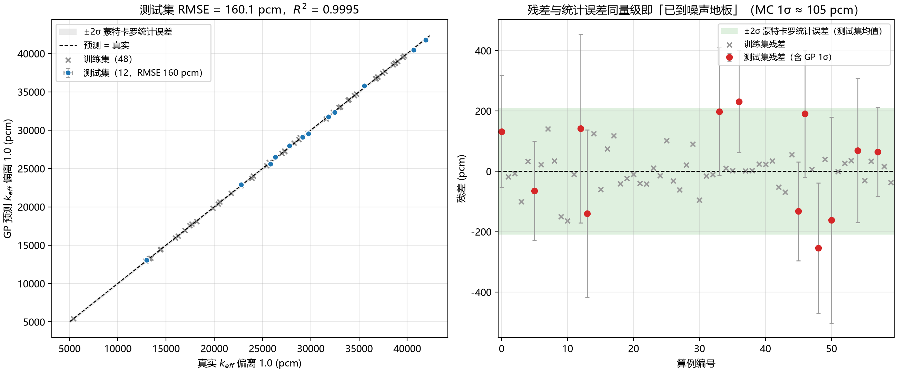
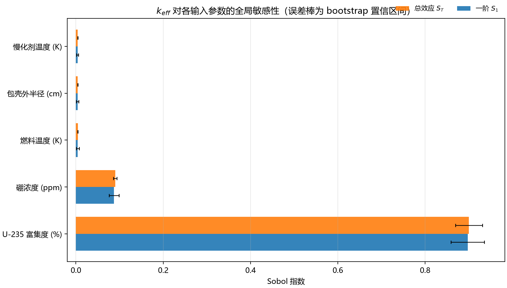
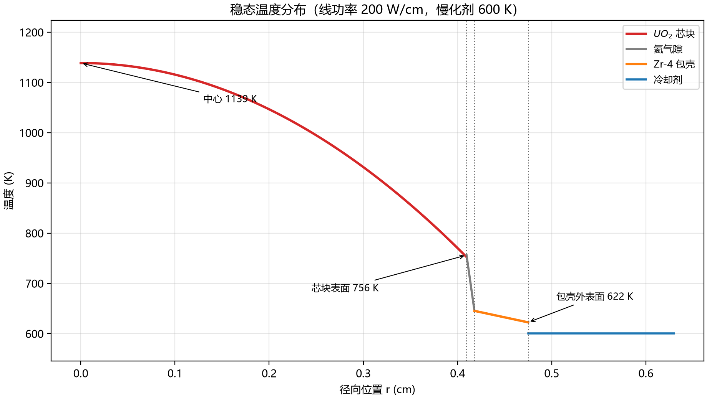

# OpenMC-Reactor-Physics

**压水堆单栅元：OpenMC 蒙特卡罗输运 → 高斯过程代理模型 → Sobol 敏感性 → 临界设计寻优 → 一维热工耦合**

[](https://www.python.org/)
[](https://openmc.org/)
[](tests/)
[](LICENSE)

---

## 目录

- [1. 这是什么](#1-这是什么)
- [2. 三条结论（先说最重要的）](#2-三条结论先说最重要的)
- [3. 快速开始](#3-快速开始)
- [4. 项目结构](#4-项目结构)
- [5. 物理模型](#5-物理模型)
- [6. 数学模型](#6-数学模型)
- [7. 结果](#7-结果)
- [8. 复现步骤](#8-复现步骤)
- [9. 从 v1 到 v2 的变更](#9-从-v1-到-v2-的变更)
- [10. 已知局限](#10-已知局限)
- [11. 引用与许可](#11-引用与许可)

---

## 1. 这是什么

一个**教学/研究用**的压水堆（PWR）单栅元计算链，覆盖从"跑一个输运算例"到"反解临界设计"的完整环节：

| 层次 | 内容 | 入口 |
| --- | --- | --- |
| 物理层 | OpenMC 连续能量蒙特卡罗输运，UO₂/Zircaloy-4/含硼水 | `src/models/pin_cell.py` |
| 数据层 | 拉丁超立方采样批量计算、断点续跑、JSONL 落盘 | `src/run_batch.py` |
| 代理层 | 5 维高斯过程回归，带蒙特卡罗噪声地板对照 | `src/train_surrogate.py` |
| 分析层 | Sobol 全局敏感性 + 一维热工-中子学耦合 | `src/sensitivity_analysis.py`、`src/coupled_pin.py` |
| 寻优层 | 差分进化反解临界富集度/硼浓度 | `src/optimize.py` |
| 展示层 | Streamlit 交互界面 | `web_app.py` |

依赖关系：



## 2. 三条结论（先说最重要的）

1. **代理模型精度已经到蒙特卡罗噪声地板。** 5 维 GP 在 12 个测试算例上 RMSE **160.1 pcm**，而算例自身的蒙特卡罗 1σ 平均 **105.0 pcm** —— 残差/统计误差 = 1.52。再换核函数（RBF 208 pcm、Dot+RBF 178 pcm）也不会显著更好，因为下面已经没有信号了。
2. **"达到临界"必须报告置信区间，而不是只报 k=1.000。** 寻优给出的临界点在 (1.73 wt%, 1988 ppm)，但该点的 GP 1σ 是 **1073 pcm**，而且硼浓度已经超出训练数据上界（1190 ppm）。程序会自己打印这两条警告——**这个点必须用 OpenMC 直接复核才能采信**。
3. **原版 README 的 134.75 pcm / R²=0.9996 复现不出来。** 用原版 3 维特征（去掉两个温度）在同一份数据上重跑，得到的是 **1236.8 pcm / R²=0.9727**（15 个随机种子结果完全一致，不是运气问题）。原因见 [第 9 节](#9-从-v1-到-v2-的变更)。

> 诚实声明：仓库自带的 `data/processed/vera_p1_dataset.csv` 是由**旧物理模型**算出来的（文件里的 `physics_version` 列不存在，加载时标记为 `legacy`）。几何修正后这批数据在物理上已不成立（见 5.3），**所有指标都应视为"代理模型方法论"的演示，而不是物理精度结论**。重新生成数据需要安装 OpenMC。

## 3. 快速开始

### 3.1 安装

```bash
# 1) OpenMC 只能走 conda-forge（pip 装不上输运求解器）
conda create -n reactor-physics python=3.11 -y
conda activate reactor-physics
conda install -c conda-forge openmc

# 2) 其余依赖
pip install -r requirements/requirements.txt
# 想用界面再加：pip install streamlit
```

**不需要 OpenMC 也能跑的部分**：代理模型训练、敏感性分析、寻优、一维热工耦合、全部单元测试。OpenMC 只在"生成数据"和"复核设计点"时被调用（`src/models/pin_cell.py` 里是惰性导入）。

### 3.2 自检

```bash
python -m src.validate --check
```

会检查几何是否自洽、采样边界是否落在可行域、慢化剂温度是否低于 15.5 MPa 的饱和温度 617.94 K、硼浓度换算是否正确。示例输出：

```
[配置自检] physics_version = 2.0
  几何：芯块 0.4096 / 包壳内 0.4180 / 包壳外 0.4750 / 栅距 1.26 cm  ✓
  气隙：0.0084 cm = 84.0 μm  ✓
  慢化剂：上限 615.0 K < 饱和温度 617.94 K @15.5 MPa  ✓
  冷却剂密度：IAPWS 600 K = 0.6611 g/cm³；基准题 0.743 g/cm³（两者不可混用）
  硼浓度：上限 2500 ppm ↔ B/H2O = 4.1764e-03（质量分数换算）  ✓
结论：通过
```

加 `--json` 可拿到机器可读结果，供 CI 判断。

### 3.3 跑通不需要 OpenMC 的链路

```bash
python -m src.train_surrogate           # 训练 + 出图 → results/
python -m src.sensitivity_analysis      # Sobol 指数   → results/sensitivity.json
python -m src.optimize --save results/optimization.json   # 临界设计寻优
python -m src.coupled_pin               # 一维热工耦合 → results/coupled_pin.json
streamlit run web_app.py                # 交互界面（需 pip install streamlit）
```

## 4. 项目结构

```
OpenMC-Reactor-Physics/
├── configs/
│   └── params.yaml              # 唯一参数入口：几何、物性、采样、训练、寻优、敏感性
├── src/
│   ├── config.py                # 配置/路径（点号访问、路径解析）
│   ├── physics.py               # 物性关联式、硼换算、几何校验（无第三方依赖）
│   ├── data.py                  # 数据集 schema、JSONL 断点续跑
│   ├── plotting.py              # matplotlib 中文字体配置
│   ├── models/
│   │   └── pin_cell.py          # OpenMC 单栅元模型（4 区：芯块/气隙/包壳/慢化剂）
│   ├── run_batch.py             # LHS 采样 + 多进程批量计算
│   ├── surrogate.py             # GP 代理模型（核函数、指标、交叉验证、存取）
│   ├── train_surrogate.py       # 训练入口 + 对比图
│   ├── optimize.py              # 临界设计（差分进化 / SLSQP）
│   ├── sensitivity_analysis.py  # Sobol 全局敏感性
│   ├── coupled_pin.py           # 一维热工-中子学耦合（Picard 迭代）
│   └── validate.py              # 配置自检 + 基准题对照
├── benchmarks/                  # C5G7 / VERA P1 附加算例（与主链解耦）
│   ├── README.md
│   ├── c5g7_core.py / c5g7_mg.py / vera_p1.py
│   ├── build_model.py / assembly.py / scan.py / plot.py
│   └── figures/                 # 示例输出（需自备 mgxs 库）
├── data/
│   ├── raw/                     # 原始状态点（gitignore）
│   └── processed/
│       └── vera_p1_dataset.csv  # 60 个算例（legacy 物理版本）
├── docs/figures/                # README 用图
├── results/                     # 模型、指标、寻优结果（gitignore）
├── tests/                       # 50 个单元测试，全部不需要 OpenMC
├── web_app.py                   # Streamlit 界面
├── pyproject.toml
└── requirements/
```

## 5. 物理模型

### 5.1 几何与材料（VERA P1 单栅元）

| 参数 | 数值 | 说明 |
| --- | --- | --- |
| 芯块半径 | 0.4096 cm | UO₂，直径 0.8192 cm |
| 包壳内半径 | 0.4180 cm | 与芯块之间 84 μm 氦气隙 |
| 包壳外半径 | 0.4750 cm | Zircaloy-4，壁厚 0.057 cm |
| 栅距 | 1.26 cm | 方形栅格 |
| 燃料密度 | 10.257 g/cm³ | UO₂ 理论密度的 95% |
| 冷却剂 | 15.5 MPa 含硼水 | 参数化研究用 IAPWS 密度；基准态用 0.743 g/cm³ |
| 富集度 | 3.1 wt% | 基准态 |
| 硼浓度 | 1300 ppm（质量） | 基准态 |

### 5.2 边界条件

四周反射（单栅元等效无限栅格），`k_eff` 即 `k_inf`。温度用 OpenMC 的 `interpolation` 方法处理截面多普勒展宽。

### 5.3 三个必须在模型里做对的细节

**(1) 芯块-包壳气隙不能被吃掉。** 旧代码令燃料圆柱半径 = 包壳内半径，等价于把 84 μm 的气隙填成燃料，燃料体积偏大 **4.2%**。现在 `Fuel` 到 0.4096、`Gap` 填 1 atm 氦、`Clad` 从 0.4180 到 0.4750，四个区各占一个 cell。

**(2) 硼浓度是质量 ppm，不是原子分数。** `add_element('B', ppm*1e-6)` 默认按**原子分数**解释，而对 H₂O 来说 1 个 B 原子对应 3 个原子，导致实际硼量只有目标值的 **1/1.66**。旧数据的线性拟合给出 −6.17 pcm/ppm，而物理上应约 −10 pcm/ppm，差的正好是 1.66 倍。现在用 `percent_type='wo'`，1300 ppm ↔ B/H₂O = 2.169e-3。

**(3) 冷却剂密度要跟温度走。** 旧代码 `0.743 - 0.001*(T-600)` 在 500 K 给出 0.843 g/cm³（比 IAPWS 的 0.8428 只差一点，纯属巧合），在 650 K 给出 0.693（超出饱和线）。现在内置 470–610 K 的 IAPWS 表并线性插值，600 K 处为 **0.6611 g/cm³**。

> 注意：VERA P1 基准题规定的 0.743 g/cm³ 对应约 567 K 的水，与"600 K"自相矛盾。仓库因此提供两个模型：`iapws_table`（参数化研究，物理自洽）和 `constant`（复现基准态，可与官方答案对比）。**不要混用**。

## 6. 数学模型

### 6.1 代理模型

以 5 维输入 $\mathbf{x}=(e, c, r_c, T_f, T_m)$ 拟合 $k_{eff}$：

$$
k_{eff}(\mathbf{x}) \sim \mathcal{GP}\bigl(m(\mathbf{x}),\, k(\mathbf{x},\mathbf{x}')\bigr),\qquad
k(\mathbf{x},\mathbf{x}') = \sigma_f^2 \cdot \mathrm{Matern}_{\nu=2.5}(\mathbf{x},\mathbf{x}') + \sigma_n^2 \delta_{\mathbf{x}\mathbf{x}'}
$$

- 输入先做 `StandardScaler`，核函数用 Matérn(ν=2.5)（比 RBF 更允许局部粗糙，实测 160.1 vs 208.0 pcm）。
- `normalize_y=False`：一旦标准化输出，`WhiteKernel` 的噪声方差就失去物理含义，拟合出的"噪声"会变成 1000 pcm 量级（实测），于是再也无法用"残差 ≈ 蒙特卡罗 1σ"判断是否到噪声地板。
- 噪声方差限制在 $[10^{-9}, 10^{-4}]$，对应 1σ 约 3–316 pcm；OpenMC 的 1σ ≈ 100 pcm，方差 ≈ $10^{-6}$，正好在区间内。

### 6.2 临界设计寻优

目标函数**必须用 pcm 量纲**：

$$
\min_{\mathbf{x}} \; \bigl| (k_{pred}(\mathbf{x}) - 1)\times 10^{5} \bigr|
$$

这不是风格问题。原版写的是 `abs(k - 1.0)`，目标数量级 $10^{-2}$；SLSQP 的有限差分步长约 $10^{-8}\times\max(1, 600)\approx 9\times10^{-6}$ ppm，而 $\partial k/\partial c \approx -6\times 10^{-5}$/ppm，于是 $\Delta f \approx 9\times10^{-11}$，**低于浮点数分辨率**——梯度恒为 0，优化器在第 4 次迭代就"成功收敛"到初始点 $(2.5\%, 500\ \mathrm{ppm})$，$k=1.086$，误差 **8629 pcm**，却打印 `Optimization terminated successfully`。

放大 $10^5$ 倍后目标量级变成 1000+，梯度重新可分辨；或者直接用差分进化（本仓库默认）。两种方法都会同时给出 `active_bounds`、`extrapolation`、`k_pred_sigma` 三类警告。

### 6.3 Sobol 敏感性

用 SALib 的 Saltelli 采样，基础样本数 $N$ 使得总评估次数 $N(2D+2)$ 在代理模型上可以承受（默认 $N=4096$，$D=5$ → 28672 次预测，约 1 秒）。输出取 $k_{eff}$ 偏离 1.0 的 pcm 值，一阶指数 $S_1$ 与总效应 $S_T$ 的差值即交互作用。

分析区间取**配置边界与训练数据范围的交集**——否则会在没有任何数据支撑的区域上做外推分解，指数看起来漂亮但毫无意义。

## 7. 结果

### 7.1 代理模型

| 指标 | 数值 |
| --- | --- |
| 训练/测试算例 | 48 / 12 |
| 测试集 RMSE | **160.1 pcm** |
| 测试集 MAE | 148.4 pcm |
| 最大绝对误差 | 254.1 pcm |
| $R^2$ | 0.9995 |
| 蒙特卡罗 1σ 平均 | 105.0 pcm |
| 残差 / 统计误差 | **1.52** |
| 5 折交叉验证 RMSE | 177.8 ± 12.5 pcm |



左图灰色叉号是训练点、蓝色是测试点；右图阴影是 ±2σ 的蒙特卡罗统计误差带。**残差与统计误差同量级，说明模型已经到噪声地板**——这时候再追求更低的 RMSE 只是在拟合噪声。

### 7.2 Sobol 全局敏感性

| 参数 | $S_1$ | $S_T$ | 交互作用 |
| --- | --- | --- | --- |
| U-235 富集度 | 0.8975 ± 0.0383 | 0.9005 ± 0.0311 | 0.0030 |
| 硼浓度 | 0.0872 ± 0.0113 | 0.0901 ± 0.0040 | 0.0029 |
| 燃料温度 | 0.0042 ± 0.0032 | 0.0044 ± 0.0002 | 0.0002 |
| 包壳外半径 | 0.0038 ± 0.0027 | 0.0043 ± 0.0002 | 0.0005 |
| 慢化剂温度 | 0.0037 ± 0.0022 | 0.0041 ± 0.0004 | 0.0004 |

$\sum S_1 = 0.9964$，$\sum S_T = 1.0034$（≈1，分解自洽）。富集度主导是因为它的采样区间宽达 1.5–5.0 wt%（$k$ 变化约 27000 pcm）；**在窄工况带内比较时，硼浓度的相对重要性会显著上升**。



### 7.3 临界设计寻优

| 项 | 数值 |
| --- | --- |
| 最优富集度 | **1.7255 wt%** |
| 最优硼浓度 | **1987.9 ppm** |
| $k_{eff}$（代理模型） | 1.00000 ± 0.01073 |
| 残差 | 0 pcm |
| 评估次数 | 11827 |
| 警告 | ⚠ 硼浓度超出训练数据范围（≤1190 ppm）；⚠ 最优点 GP 1σ = 1073 pcm |

**这个结果不能直接当结论用。** 在旧数据上，$k=1$ 的解集是一条直线，差分进化只保证找到其中一个点；而且硼浓度已经外推到数据之外，GP 的不确定度也大到与残差同量级。正确的下一步是把它丢回 OpenMC 直接算，见 `python -m src.validate --design results/optimization.json`。

### 7.4 一维热工-中子学耦合

线功率 200 W/cm、慢化剂 600 K：

| 量 | 数值 |
| --- | --- |
| 芯块中心温度 | 1138.5 K |
| 芯块表面温度 | 756.2 K |
| 芯块平均温度 | 947.4 K |
| 包壳内/外表面 | 645.2 / 622.3 K |
| 温降分配 | 芯块 382.3 K / 气隙 111.0 K / 包壳 22.9 K / 膜 22.3 K |
| 气隙热阻占比 | 20.6% |
| Picard 迭代 | 14 次收敛（松弛因子 0.5） |
| 燃料温度系数 | −3.09 pcm/K |



热工部分解 $\int_{T_s}^{T_c} k(T)\,\mathrm{d}T = q'/(4\pi)$（`brentq` 求解），气隙/包壳/液膜用串联热阻；$k_{UO_2}(T)$ 随温度下降，因此"燃料温度 ↑ → 导热 ↓ → 温度更高"需要松弛迭代才能收敛——这就是耦合的全部内容，没有隐藏的"人为设定热阻"。

## 8. 复现步骤

```bash
# ① 重新生成数据（需要 OpenMC；约 60 算例 × 100 batch × 10000 粒子）
python -m src.run_batch --workers 4          # 中断后加 --resume 继续
python -m src.validate                       # 与基准解对照

# ② 训练与出图
python -m src.train_surrogate --cv 5

# ③ 敏感性
python -m src.sensitivity_analysis

# ④ 寻优（结果写入 results/optimization.json）
python -m src.optimize --save results/optimization.json
python -m src.validate --design results/optimization.json   # 需 OpenMC 复核

# ⑤ 热工耦合
python -m src.coupled_pin --power 200 --mod-temp 600

# ⑥ 测试
python -m pytest -q
```

常用参数都在 `configs/params.yaml`；脚本本身不再硬编码任何数值（旧版 `batches=100, particles=10000` 写死在类里，改一次要翻三个文件）。

## 9. 从 v1 到 v2 的变更

| 类别 | 问题 | 修复 |
| --- | --- | --- |
| **物理** | 气隙被燃料填满（燃料体积 +4.2%） | 4 区几何：芯块 / 氦气隙 / 包壳 / 慢化剂 |
| **物理** | 硼按原子分数添加，实际只有 1/1.66 | `percent_type='wo'`，1300 ppm ↔ 2.169e-3 |
| **物理** | Zircaloy 质量分数只有 Zr 0.98 + Sn 0.015 | Zr-4 四元素（Sn/Fe/Cr/O）+ Zr 余量 |
| **物理** | 冷却剂密度线性外推，650 K 越过饱和线 | IAPWS 表插值；采样上限 615 K < 617.94 K |
| **物理** | 无随机种子，算例不可复现 | `seed = base + case_id` |
| **物理** | 直接用 h5py 读 `k_combined` | `openmc.StatePoint` API |
| **数值** | 目标 `abs(k-1)` 使梯度低于浮点精度，SLSQP 静默返回初值 | pcm 量纲目标 + 差分进化 |
| **数值** | 3 维特征丢了两个温度（1236.8 pcm） | 5 维特征（160.1 pcm） |
| **数值** | `normalize_y` 让噪声项失去意义 | 关闭并锁定噪声区间 |
| **工程** | 输出目录相对 CWD，从仓库根跑会把状态点写到仓库外 | 全部路径基于 `Path(__file__).parents[1]` |
| **工程** | `max_workers = cpu-1` 与 OpenMC 线程叠加导致超订 | `workers = cpu // threads_per_case` |
| **工程** | 失败算例只写 `{case_id, status}`，CSV 参差不齐 | 固定 schema，失败也写全字段 |
| **工程** | 无断点续跑 | 每算例追加 JSONL，`--resume` 跳过已完成 |
| **工程** | 训练脚本顶层导入 OpenMC，没装就 ImportError | 惰性导入，`--no-openmc` 链路可独立运行 |
| **工程** | Streamlit 用随机数造假数据却宣称"基于 OpenMC" | 读取真实模型与指标，缺模型时明确报错 |
| **工程** | 目录里没有 tests/、LICENSE、pyproject.toml、CI | 全部补齐（50 个测试） |
| **仓库** | `openmc` 被误提交成 gitlink（没有 `.gitmodules`），`git clone` 会直接报错 | 移除该引用；OpenMC 通过 conda 安装 |
| **仓库** | 提交了 `tallies.out`、重复的 `build_model.pyx`、根目录散落的 PNG | 删除；示例图移入 `benchmarks/figures/` |
| **基准** | C5G7 的包壳 cell 填的是水 | 填 Zircaloy-4；新增栅元中平面 Plot |
| **基准** | `scan.py` 删除目录下所有 `.h5`（会删掉 mgxs 库） | 只删 `statepoint.*.h5` |
| **基准** | 扫描结果靠人手抄进 `plot.py` 的硬编码列表 | 写 `scan_results.csv`，`plot.py` 读它 |

> 关于 134.75 pcm 的来历：用旧版 3 维特征、同一份数据、15 个随机种子重跑，测试 RMSE 稳定在 1236.8 pcm（R² 0.9727）。原 README 的数字很可能来自另一批（100 组、且不含温度变量）的数据——那批数据已不在仓库里。**这正是"数字必须可由仓库内的代码复现"的意义。**

## 10. 已知局限

1. **自带数据集是 legacy 物理版本。** 几何修正后，旧的 `clad_r ∈ [0.4504, 0.49]` 会让包壳内半径小于芯块半径，物理上不存在。现有 60 个算例只能用来演示方法论，重新生成需装 OpenMC。
2. **临界寻优是"在代理模型上"寻优。** 任何最优设计都必须用 OpenMC 直接复核（`src/validate.py` 提供了入口），尤其是落在边界或训练范围外的点。
3. **$k=1$ 的解是一条线，不是一个点。** 只寻优富集度和硼浓度时，解集是二维曲面与 $k=1$ 的交线，差分进化返回其中之一。若要唯一解，需要加约束（如硼浓度上限、富集度最小化）。
4. **C5G7 基准是简化的。** `benchmarks/` 下的布局（控制棒/导向管排布、裂变室尺寸）与官方 C5G7 不一致，结果**不可与官方基准直接比较**，只用于演示流程。
5. **一维热工模型不含子通道分析**，单相、无沸腾、物性只随温度变化，适用于正常工况的参数扫描，不适用于事故分析。
6. **CI 不跑 OpenMC**（装起来太重），因此 CI 只覆盖代理模型/物性/热工这条链。

## 11. 引用与许可

MIT License，见 [LICENSE](LICENSE)。引用信息见 [CITATION.cff](CITATION.cff)。

参考文献：

- VERA Core Physics Benchmark Progression Problem Specifications, CASL-U-2012-0131-004, Rev. 4 (2014).
- B. Forget et al., *Benchmark Specification of the C5G7 MOX Fuel Assembly Problem*, NEA/OECD (2003).
- IAPWS-IF97, *Revised Release on the IAPWS Industrial Formulation 1997*.
- D. Foreman-Mackey et al., *emcee*（GP 实现参见 scikit-learn `GaussianProcessRegressor`）。
- A. Saltelli et al., *Global Sensitivity Analysis: The Primer*, Wiley (2008).

如果这个仓库的代码或其中的几个"坑"对你的工作有帮助，欢迎开 issue 指正。
