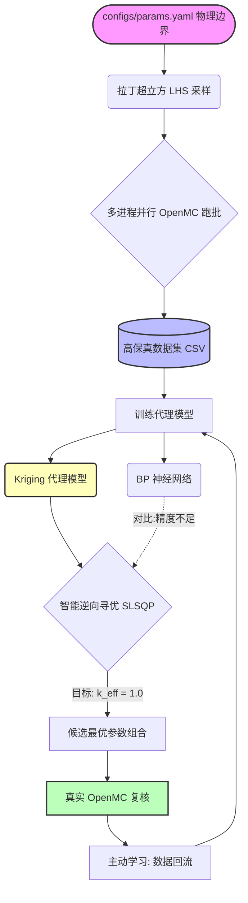

# ⚛️ OpenMC-Reactor-Physics: AI 代理模型与智能逆向寻优系统


##  项目简介

在核反应堆物理计算中，高保真蒙特卡洛（Monte Carlo）程序（如 OpenMC）虽然计算精度极高，但其单次运算耗时较长，难以直接应用于需要海量样本（如几十万组）的多目标优化、敏感性分析或数字孪生中。

本项目以 **VERA Benchmark Problem 1 (PWR 单栅元)** 为物理对象，旨在构建一套**“高保真数据生成 -> 机器学习代理模型 (Surrogate Model) -> 智能逆向寻优 -> 主动学习 (Active Learning)”**的完整闭环系统。

###  核心亮点
-  **面向对象物理建模**：将复杂的物理几何、材料、参数封装为 `VeraPinCell` 类，一行代码驱动模型。
- **高效数据生成引擎**：结合拉丁超立方采样 (LHS) 与 Python 多进程并发 (`ProcessPoolExecutor`)，10 分钟内并行生成 100 组高保真数据集。
-  **高精度代理模型**：引入高斯过程回归 (Kriging) 完美处理小样本与蒙特卡洛统计涨落噪声，测试集误差低至 **~134 pcm**，\(R^2\) 达 **0.9996**。
-  **智能逆向设计**：利用 `scipy.optimize` 驱动代理模型，在毫秒级时间内完成临界状态的参数寻优，并自动调用 OpenMC 进行真实复核。
-  **主动学习闭环**：将寻优结果自动回流至数据库更新模型，实现 AI 的自我迭代。

---

##  系统架构与技术路线



数学与算法基础

1. Kriging (高斯过程回归)：
   假设预测值服从多元正态分布，不仅输出预测均值 \mu(x)，还输出预测方差 \sigma^2(x)。其核函数 (Kernel) 采用了 RBF (径向基) 与 WhiteKernel (白噪声) 的组合：
   

k(x, x') = \sigma_f^2 \exp\left(-\frac{(x - x')^2}{2l^2}\right) + \sigma_n^2 \delta(x, x') 
]
其中 \sigma_n^2 有效吸收了 OpenMC 蒙特卡洛计算的固有统计涨落。

2. 智能寻优的目标函数：
   我们要寻找一组参数 x = [Enrichment, Boron]，在固定包壳尺寸 Clad 下，使得反应性逼近临界：
   

\min_{x \in \mathcal{X}} \left| \hat{k}_{eff}(x, Clad) - 1.0 \right| 
]

---

 结果展示与分析

1. 代理模型性能评估

我们将 100 组数据集按 8:2 划分训练集与测试集，在测试集上的表现如下：

算法模型 均方根误差 (RMSE) 决定系数 (R^2) 训练耗时
Kriging (高斯过程) 134.75 pcm 0.9996 < 1s
BP 神经网络 (MLP) 16226.23 pcm -4.5676 < 1s

结论：在仅有 80 组小样本高保真数据的情况下，基于贝叶斯推断的 Kriging 模型展现出了极其强大的非线性拟合能力，且能提供预测置信区间。而 BP 神经网络由于参数量大，发生了严重的过拟合与梯度崩溃。

2. 预测散点图对比

图中蓝色点为 Kriging 模型（带 95% 置信区间误差棒），绿色点为 BP 模型。

results/figures/prediction_comparison.png

3. 逆向寻优与高保真验证

通过代理模型搜寻到的临界参数组合，经 OpenMC 真实输运复核：

· 代理模型误差：~ 109 pcm
· 计算效率提升：从单次 45 秒 缩短至 0.001 秒（提升约 4.5 万倍）

---

代码目录结构

```text
├── benchmarks/            # 传统静态基准题验证脚本 (C5G7, VERA P1)
├── configs/               
│   └── params.yaml        # 采样参数范围与 OpenMC 运行控制参数
├── src/
│   ├── models/
│   │   └── pin_cell.py    # 核心: 面向对象的 VERA P1 物理模型构建
│   ├── run_batch.py       # LHS 采样 + 多进程批量驱动 OpenMC 计算
│   └── train_surrogate.py # 代理模型训练 + 智能寻优 + 主动学习验证
├── data/
│   ├── raw/               # OpenMC 原始输出 (statepoint.h5, 自动 gitignore)
│   └── processed/         # 提取的 CSV 数据集 (用于 AI 训练)
├── results/
│   └── figures/           # 模型评估的对比图
├── tests/                 # (可选) pytest 单元测试
└── README.md
```

---

快速复现指南

1. 环境依赖

建议使用 Conda 环境（假设已安装 OpenMC 及其交叉截面库）：

```bash
conda create -n openmc-ai python=3.10
conda activate openmc-ai
pip install openmc pandas scipy scikit-learn matplotlib pyyaml h5py
```

2. 生成高保真数据集

修改 configs/params.yaml 中的边界，然后运行：

```bash
python src/run_batch.py
```

(根据你的 CPU 核心数，生成 100 组数据预计耗时 10~20 分钟，结果保存在 data/processed/)

3. 训练模型并执行寻优

```bash
python src/train_surrogate.py
```

(脚本将自动完成：训练 -> 画图 -> 寻优 -> OpenMC 验证 -> 主动学习更新)

---

 后续研究展望 (Roadmap)

☐ 扩展特征维度：引入燃料芯块直径、慢化剂温度等，结合 Sobol 指数法 进行全局敏感性分析。
☐ 引入时间演化：接入 openmc.deplete 燃耗模块，提取 1000 天内的核素演化，使用 LSTM 或 时序 Transformer 预测长周期临界安全。
☐ 多物理场耦合：提取 heating tally，利用 KD-Tree 映射到一维热工网格，实现简单的中子-热工闭环耦合。
☐ 底层加速：将部分 Python 批处理逻辑重写为 C++/MPI，以适配超算集群。