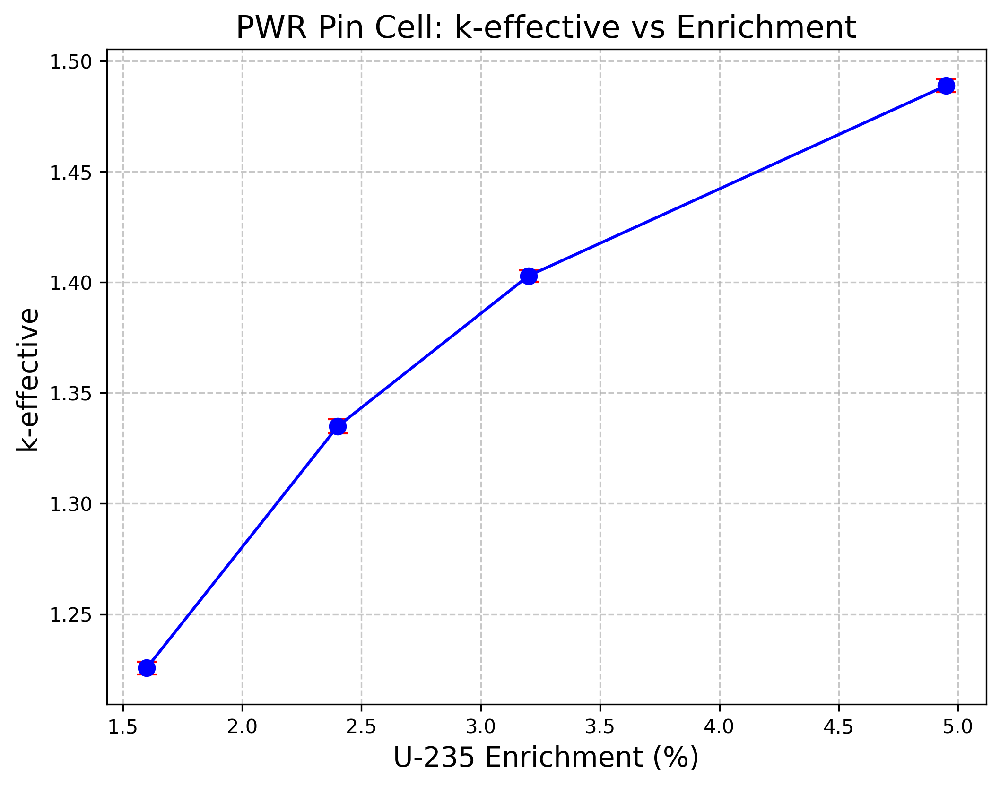

# PWR Pin Cell Enrichment Scan (OpenMC)

基于 OpenMC 蒙特卡洛程序，构建 PWR 单栅元模型，并进行 U-235 富集度扫描计算。

## 计算结果

计算了四种不同 U-235 富集度下的有效增殖因子 \(k_{eff}\)：

| 富集度 (%) | \(k_{eff}\) | 标准差 (std dev) |
| :---: | :---: | :---: |
| 1.6 | 1.22571 | 0.00294 |
| 2.4 | 1.33484 | 0.00319 |
| 3.2 | 1.40286 | 0.00259 |
| 4.95 | 1.48882 | 0.00297 |

*图：U-235 富集度与系统有效增殖因子 k_eff 呈良好的线性正相关关系*

## 文件说明

- `build_model.py`: 生成基础单栅元模型的 XML 输入卡
- `scan.py`: 自动化遍历不同富集度进行计算并提取结果的脚本
- `plot.py`: 读取计算结果并绘制曲线图

##  环境要求

- OpenMC (通过 conda-forge 安装)
- Python 3.8+
- Matplotlib
